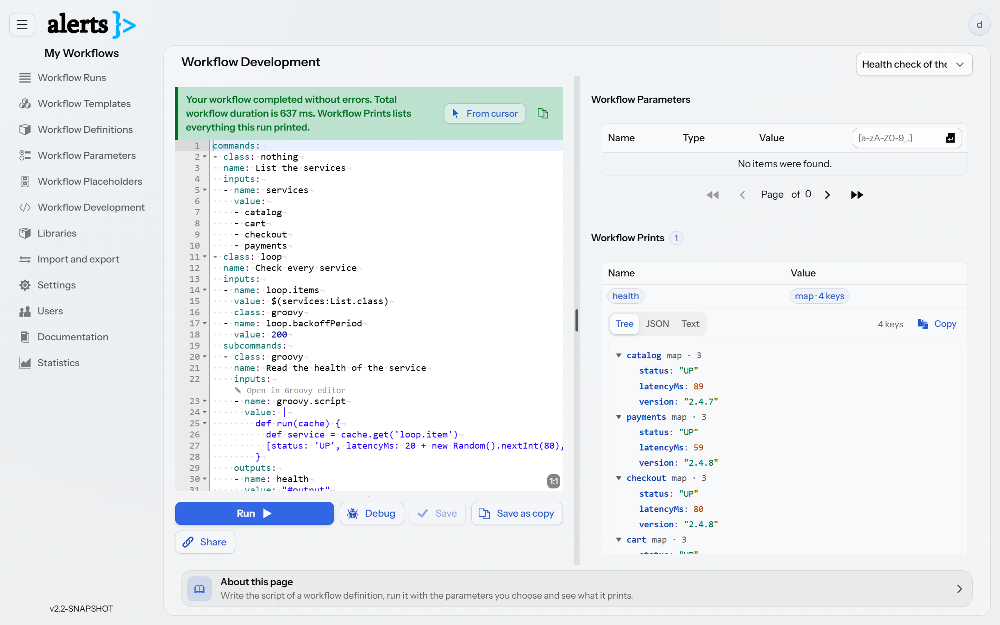
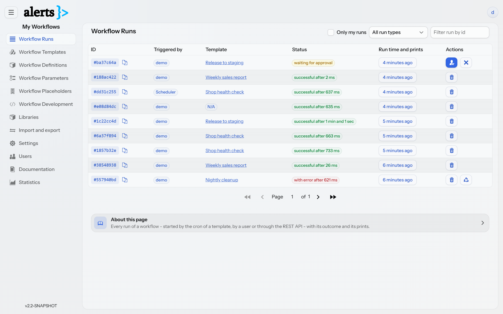
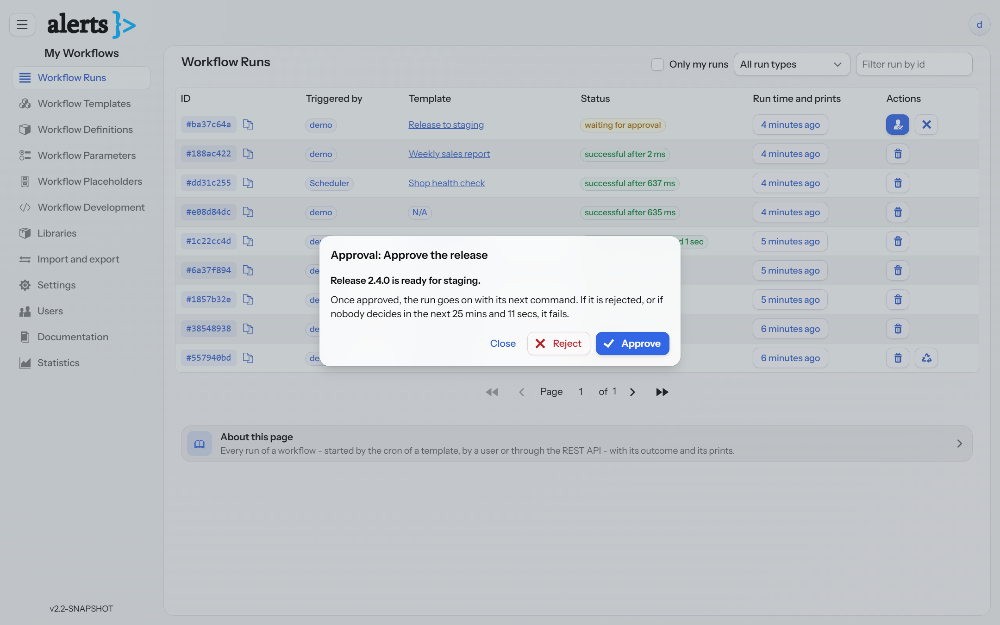
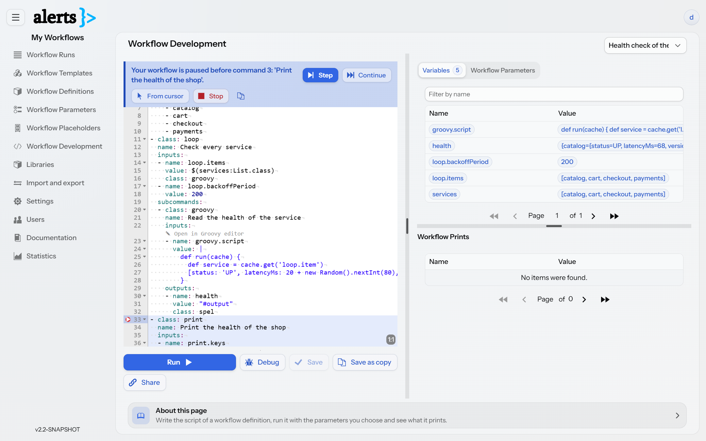
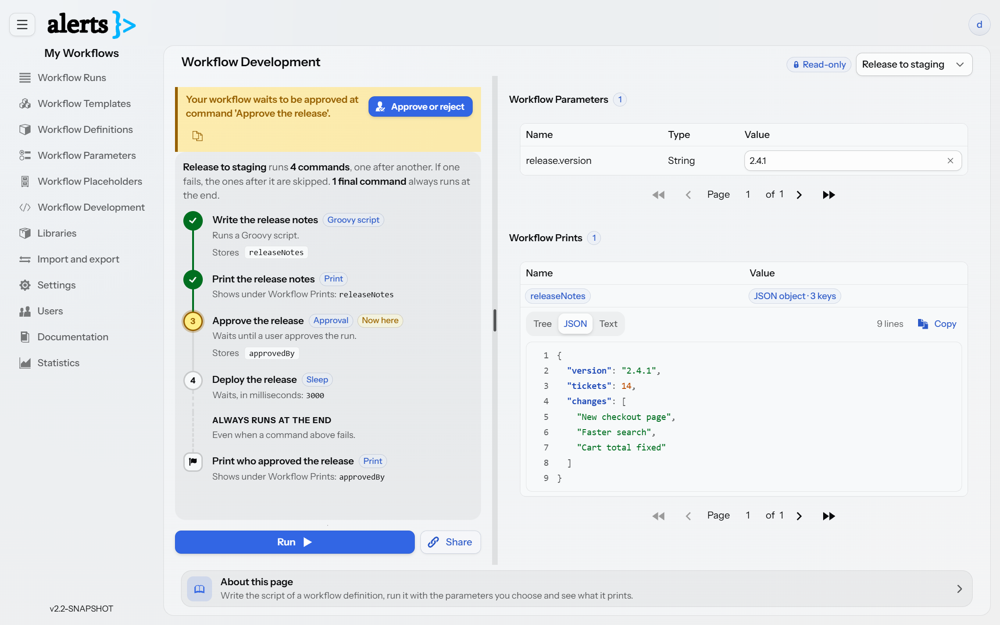
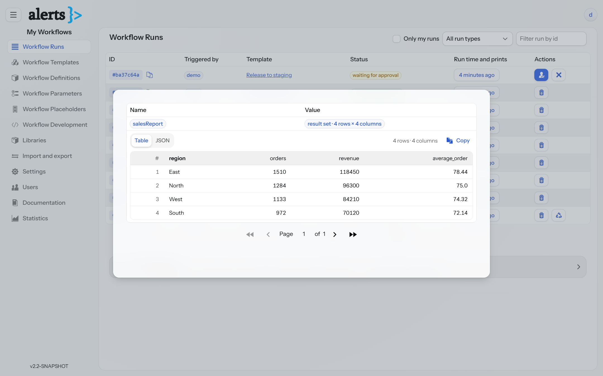
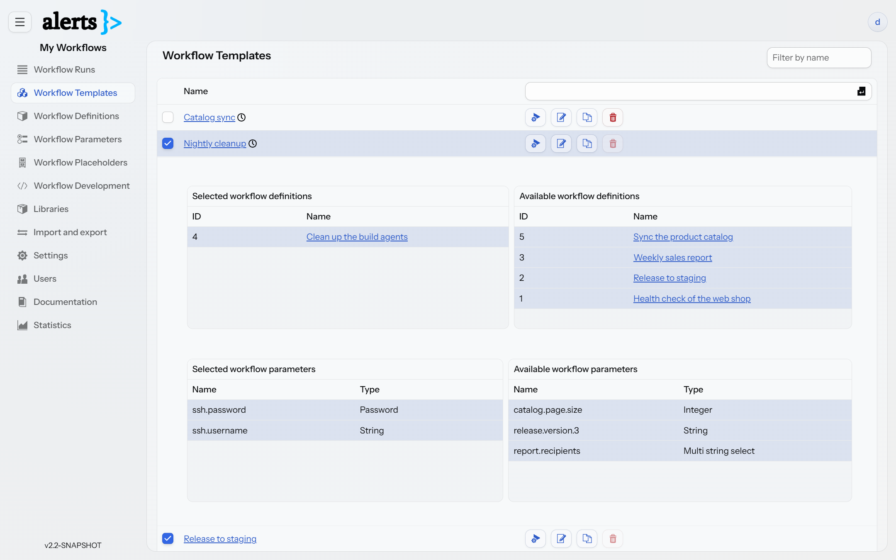
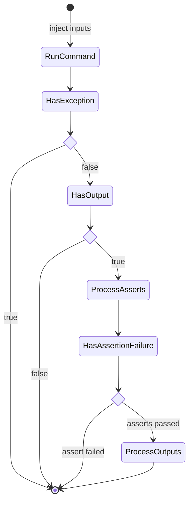

# MyWorkflows

[MyWorkflows](https://myworkflows.org) is a simple tool that helps you automate manual tasks.
It lets you encapsulate manual tasks as workflows, schedule them, and view their outputs.

The tool is written in Java and uses Vaadin as its UI framework.

MyWorkflows is ideal for small teams overwhelmed by daily manual tasks.
All workflows are defined in YAML, and the tool provides an intuitive UI for working with them.



More of the application under [Screenshots](#screenshots).

## Technology stack

* Java 25 as the programming language.
* Spring Boot 4 as the application and DI framework.
* [Vaadin 25](https://vaadin.com) as the UI framework.
* [SQLite](https://www.sqlite.org/) as the relational database for persisting data.
* [Flyway](https://github.com/flyway/flyway) for database schema migrations.
* [JSON Schema Validator](https://github.com/networknt/json-schema-validator) for validating workflow scripts.
* [Groovy](https://groovy-lang.org/) as an additional language for defining commands.
* [Janino](https://www.janino.net/) as the Java runtime compiler.
* [SpEL](https://docs.spring.io/spring-framework/reference/core/expressions.html) as another runtime evaluator.

## Features

* **Modern, responsive UI** for a better user experience.
* **Authentication** and **authorization** enabled by default for secure access.
* A dedicated web page for managing **users**, for admins: add a user, disable one, make one an admin or reset a
  password. A new or a reset password is temporary and shown once; its user is asked for one of their own at login, and
  so are the two default accounts, `user` and `admin`, as long as they have the password they were installed with.
* A **profile** page for every user, under the avatar: change the password, create named API tokens - with an expiry,
  if wanted - and revoke them.
* **Vaadin Push** enabled: using WebSockets, the server can send real-time updates to the client.
* **Persistence layer** powered by **SQLite** for reliable data storage.
* A dedicated page for **workflow definition script development**, which lets you:
    * Write your script.
    * Inject parameters.
    * Run the script and view its output.
    * Use an editor with auto-completion to simplify writing workflow scripts.
    * Share the script together with its parameters.
    * Hand it over as a read-only link, which shows the pipeline of the workflow instead of the editor: its commands
      in the order they run, a few words on what each of them does and, while it runs, the command the run is at.
* **Step-by-step debugging** on that page: a breakpoint next to a line number pauses a run before a command, with
  everything the run holds on display. From there the run steps one command at a time, carries on, or runs from another
  command - with the script as the editor has it by then, so a command can be fixed without running the ones before it
  again.
* **Viewers for printed values**: a map or a list is read as a tree, a text which holds JSON as formatted JSON and the
  result set of a query as a table, with its text one tab away.
* Replay of a failed workflow run, starting from the command that failed. A run can be replayed only by the user who
  triggered it, so a run scheduled by a template's cron - which belongs to no user - cannot be replayed.
* A **manual approval** step: an `approval` command keeps a run where it is until a user approves or rejects it, on the
  runs page or on the development page. It gives up after a timeout.
* Each workflow run keeps track of the user who triggered it, and the runs page can be filtered down to your own runs.
* The runs page follows the runs by itself: a run started by a cron, by another user or through the REST API shows up
  without a reload, and its badge turns into the outcome once it is over.
* Dedicated web pages for managing **workflow placeholders**, **workflow parameters**, **workflow definitions**,
  **workflow templates**, and **workflow runs**.
* **Import and export**, for admins: templates, definitions, parameters and placeholders are written to a YAML file or
  to a zip archive and read on another instance, where every item is compared with what is already there before
  anything is saved. See [Import and export](#import-and-export).
* **Duplicate** a workflow definition or a workflow template, for admins: the copy gets a name of its own, the one of
  the original followed by `(copy)` unless another is typed. A copy of a template runs the same definitions with the
  same parameters and cron, starts paused, and gets its own copy of the parameters meant for the original alone
  (`timeout.42` becomes `timeout.57`). On the development page, *Save as copy* saves the editor as a new definition and
  leaves the one it was opened with as it was saved.
* A **REST API**, off by default: workflow definitions, templates, parameters and placeholders are read, created,
  updated and deleted, and runs are started, followed, cancelled, replayed and deleted, with their printed values. A
  call has the rights its user has on the pages. See [REST API](#rest-api).
* The filters of a page live in its URL, like `/workflow/runs?mine=true&template=3`, so a filtered page survives Back and
  can be bookmarked or shared. A chip names each filter in use and removes it with a click.
* A guide on the runs, templates, definitions, parameters, placeholders, libraries, import and export and development
  pages: a legend of what the page shows, the steps of its main task and a few things worth knowing. It starts folded
  and is opened page by page.
* A dedicated web page for managing **Java libraries** at runtime.
* **Commands as plugins**: a library can bring command types of its own, which are then used in a workflow like the
  predefined ones.
* A dedicated web page for writing **Markdown documentation**. Its *Command reference* page is written by the
  application: every command a workflow can use - the ones brought by the libraries included - with its inputs, their
  type and default value, its output and an example.
* A dedicated web page for viewing and analyzing **statistics**.
* A dedicated web page for editing application **settings**.

## Screenshots

Taken on an instance with demo data only: the workflows, the user and the parameters are made up. A click on a
screenshot opens it at full size.

<table>
  <tr>
    <td width="50%">
      <a href="docs/screenshots/runs.png"></a><br>
      <strong>Workflow runs</strong> - every run with its outcome, whether a cron, a user or the REST API started it.
    </td>
    <td width="50%">
      <a href="docs/screenshots/approval.png"></a><br>
      <strong>Manual approval</strong> - a run waits at its <code>approval</code> command until a user approves or
      rejects it.
    </td>
  </tr>
  <tr>
    <td width="50%">
      <a href="docs/screenshots/debugging.png"></a><br>
      <strong>Step-by-step debugging</strong> - a run paused before a command, with everything it holds on display.
    </td>
    <td width="50%">
      <a href="docs/screenshots/pipeline.png"></a><br>
      <strong>Read-only link</strong> - the pipeline of a workflow instead of its script, and the command its run
      is at.
    </td>
  </tr>
  <tr>
    <td width="50%">
      <a href="docs/screenshots/prints.png"></a><br>
      <strong>Printed values</strong> - the result set of a <code>database</code> command, read as a table.
    </td>
    <td width="50%">
      <a href="docs/screenshots/templates.png"></a><br>
      <strong>Workflow templates</strong> - the definitions a template runs on its cron, and the parameters it hands
      over.
    </td>
  </tr>
</table>

## How does it work?

### Terminology

* **Workflow**: A list of steps that together accomplish a given task.
* **Command**: A single step in the workflow. A command has a `name`, a `class`, `ifs`, `inputs`, `asserts`, and
  `outputs`. Only `name` and `class` are mandatory. Some commands (`loop` and `waitUntilSubPasses`) also require a list
  of `subcommands`.
* **If**: A condition that must be met for the command to run. If at least one condition is not met, the command is
  skipped.
* **Input**: A parameter that customizes the current step.
* **Assert**: After a command has run, if it produced an output, you can apply assertions to that output.
* **Output**: After a command has run, if it produced an output, you can process it further (for example, save it to
  another variable).
* **Variable**: A named value stored in the workflow run cache. Variables are produced by inputs and outputs and can be
  used by subsequent commands.

### Workflow

A `workflow` is the logical entity that groups the steps (called `commands`) needed to implement a task.
Each workflow has a `name`, so you can easily identify what it does.

A workflow can be run `manually` by the user or `automatically` by a scheduler.
Behind the scenes, a `thread pool` is responsible for executing workflows.
Each workflow runs on a single thread, and its commands are run sequentially.

A workflow definition can contain at most 100 `commands` and 10 `finallyCommands`.

#### Command

Each command has:

* a `name` - identifies the command
* a `class` - defines the type of the command
* `ifs` - conditions that must all be met for the command to run
* `inputs` - customize the current run
* an `output` - the value returned by the command
* `asserts` - check the output, if one is present
* `outputs` - process the output further and save partial results in other variables

Before anything else, all `ifs` are evaluated; if any of them is not `true`, the command is skipped.
Otherwise, the following state diagram describes how a command works:



#### Workflow Templates

Workflow templates let you schedule multiple workflow definitions to run automatically, based on a cron expression.
Besides the definitions, you can select a set of workflow parameters to be injected each time the template runs.

> [!TIP]
> You can assign a workflow parameter to a specific template by suffixing the parameter name with
> `.<workflowTemplateId>`. At runtime, when the parameter is injected into the workflow, the suffix is removed.

### Features

#### `Ace` editor

The tool uses [Ace](https://ace.c9.io/) as the code editor for workflow definition scripts.
The editor is available on the `Workflow Development` page.

The editor provides:
* **Syntax highlighting**
* **Live auto-completion**
* **Snippets**
  * type `input` to insert a snippet for an input expression with `name`, `class`, and `value`.
  * type `assert` to insert a snippet for an assert expression with `name`, `class`, and `value`.
  * type `output` to insert a snippet for an output expression with `name`, `class`, and `value`.
  * type the `class` of a command - `sleep`, `httpRequest`, `sshExec`... - to insert that command with its `name`, its
    `class` and one entry of `inputs` per required input, each showing the type it expects until it is typed over. A
    command which runs other commands (`loop`, `waitUntilSubPasses`) comes with its `subcommands` too. The snippets
    are written from the commands themselves, so a command brought by a library has one as well.
* **Key bindings**
  * <kbd>Alt</kbd> + <kbd>E</kbd> = Focus the editor.
  * <kbd>Ctrl</kbd> + <kbd>A</kbd> = Select all code. Requires editor focus.
  * <kbd>Ctrl</kbd> + <kbd>F</kbd> = Search the code. Requires editor focus.
  * <kbd>Ctrl</kbd> + <kbd>L</kbd> = Go to a specific line. Requires editor focus.
  * <kbd>Ctrl</kbd> + <kbd>Alt</kbd> + <kbd>F</kbd> = Reformat the code. Requires editor focus.
  * <kbd>Ctrl</kbd> + <kbd>Alt</kbd> + <kbd>W</kbd> = Toggle line wrapping. Requires editor focus.
  * <kbd>Ctrl</kbd> + <kbd>Alt</kbd> + <kbd>J</kbd> = Open the `java.script` or `groovy.script` under the cursor in the script editor. Requires editor focus.
* **Script editor for `java` and `groovy` commands**
  * click `Open in Java editor` / `Open in Groovy editor`, shown above each `java.script` / `groovy.script` input, to edit the script in a dedicated editor with Java / Groovy syntax highlighting.
  * press <kbd>Ctrl</kbd> + <kbd>S</kbd> or click `Save` to write the script back into the workflow definition. The script is re-indented automatically, the rest of the definition (including comments) stays untouched, and <kbd>Ctrl</kbd> + <kbd>Z</kbd> in the workflow editor undoes the whole change.
* **Search and replace with regular expressions**
* **Display of hidden characters**
* **Code folding**
* **Multiple cursors and selections**
* **Live syntax checking (for YAML)**
* **Cut, copy, and paste**
* and much more

#### `Finally` commands

`Finally commands` are special commands that are executed at the end of your workflow, regardless of whether the
workflow failed.
The concept is similar to the `try-finally` block in Java.

```
try { 
  // Run all commands in sequential order
} finally {
  // Run all finallyCommands in sequential order
}
```

> [!TIP]
> A single workflow definition cannot have more than 10 finally commands.

#### Placeholders

You can use global `placeholders` to avoid duplicating data across workflow definitions.
All placeholders are resolved immediately before a workflow runs.
Placeholders are persisted in a database table called `workflow_placeholders`.

Inside a workflow definition, a placeholder has the format `$$(PLACEHOLDER_NAME)`.
You can use placeholders inside any `input`, `assert`, and `output` (in both the `name` and `value` fields), including
those of subcommands.

> [!TIP]
> A placeholder name must match the pattern `[A-Z0-9_.]+` to be recognized as a valid placeholder.

> [!TIP]
> If a placeholder cannot be found, you will get a runtime exception.

#### Expressions

Expressions are the heart of this tool.
They let you pass information between commands.
Expressions are evaluated at runtime and can be used inside any `input`, `assert`, `output`, or `if`.
Inside these structures, the expression is always placed in the `value` field.
Each expression is evaluated by the runtime evaluator specified in the `class` field.

Currently, **3 runtime evaluators** are supported:

1. Set `class` to `groovy` to use the Groovy runtime evaluator.
2. Set `class` to `java` to use the Java runtime evaluator, based on the [Janino](https://www.janino.net/) runtime
   compiler.
3. Set `class` to `spel` to use
   the [SpEL](https://docs.spring.io/spring-framework/reference/core/expressions.html) runtime evaluator.

If `class` is not set, it defaults to `plain`, which means the value is used exactly as written.

The following variables are available inside an expression:

* `cache` - the workflow run cache (in SpEL, use `#cache`).
* `output` - the command output (in SpEL, use `#output`). Available only in `asserts` and `outputs`.

##### Examples

###### Check that the exit code of the `sshExec` command is 0, using the SpEL runtime evaluator

```yaml
name: Assert that output exitCode equals 0
class: spel
value: "#output.getExitCode() == 0"
```

###### Read a value from the workflow run cache and save it to another variable (named `sleep.time`)

```yaml
name: sleep.time
class: groovy
value: "cache.get('sleepTime').toInteger()"
```

##### Cache access patterns

As the examples above show, expressions can get long and hard to write.
In addition, accessing the workflow run cache with a call such as `cache.get('sleepTime')` makes the expression
harder to read.

This is why the tool provides a simpler alternative: **cache access patterns**.

Take one of the previous examples:

```yaml
name: sleep.time
class: groovy
value: "cache.get('sleepTime').toInteger()"
```

It can be rewritten like this:

```yaml
name: sleep.time
class: groovy
value: "$(sleepTime:Integer.class)"
```

The tool recognizes every string inside `value` that matches the following regular expression:
`\$\(([a-zA-Z0-9_.]+)(:[a-zA-Z0-9_.]+)?\)`.
The text between the parentheses has two parts: the first (mandatory) is the name of the variable to look up in the
workflow run cache, and the second (optional) is the expected type of its value.

The type must be written in the syntax of the evaluator you use:

* `groovy` and `java`: a class literal, for example `$(sleepTime:Integer.class)`.
* `spel`: a fully qualified class name, for example `$(sleepTime:java.lang.Integer)`.

If the workflow run cache has no variable named `sleepTime` of type `Integer`, you will get a runtime exception while
the workflow is running.

#### How to debug workflow runs?

##### Step by step, on the development page

An admin can go through a workflow one command at a time on the **Workflow Development** page:

1. Click next to a line number, on any line of a command: a red dot on the first line of that command is its
   **breakpoint**. Click again to remove it. Breakpoints follow their command while you edit, and they are not saved
   with the definition.
2. Click **Debug** instead of *Run*. The run pauses before the first command which has a breakpoint, or before the very
   first command when there is no breakpoint. *Run* pauses nowhere, whatever the breakpoints.
3. While the run is paused, the editor marks the command it stands before and **Variables** lists everything the run
   holds - name, type and value - with what the last step added or changed on top. A value whose name contains
   `password` is masked, as it is when it is printed. **Variables** takes the place of **Workflow Parameters**, above
   the prints, from *Debug* until the next *Run*: the parameters are among what the run holds, and changing one would
   change only the next run, so they wait in the tab next to it. A plain *Run* shows no variables.
4. Tell the run how to go on:
    * **Step** runs the command it stands before, then pauses again.
    * **Continue** runs to the next breakpoint, or to the end.
    * **From cursor** carries on from the command the cursor is in, with the variables as they are: the commands in
      between are skipped, or run again when the cursor is further up.
    * **Stop** ends the run as failed. Its `finallyCommands` still run.

Every one of these reads the script from the editor again, so a command can be changed before it runs: fix the command
the run stands before, click *Step*, and the fixed command is the one that runs. A script which is not a valid workflow
leaves the run paused and says why.

Once a run is over - debugged or not - it can be started again the same way: **From cursor** starts it from the
command the cursor is in, and **From command N** from the command it did not get past. Both keep everything the
run held when it ended, so the commands that already passed are not run again. This is what the *replay* of the runs
page does, but with the script as it is in the editor now.

A few limits:

* A run pauses only before a command listed under `commands`. A breakpoint on a subcommand of a `loop` or of a
  `waitUntilSubPasses` pauses before the whole command, and the `finallyCommands` are never paused.
* The run goes on by the number of its commands: after adding or removing a command above the pause, the run stands
  before the same number, which is then another command.
* A pause lasts an hour at most, and ends when its user leaves the page: the run is then stopped. Like any run in
  progress, a paused run is lost when the application restarts.
* Only a run started from the development page, in the editor, can be debugged - not a run of a template, of the
  REST API or of a read-only link.

##### With the `debug` parameter

Any run - of a template too - can print more about itself: inject a parameter named `debug` of type `boolean` and set
it to `true`. With the debug flag enabled, the run also prints the resolved type and value of every command parameter.

#### Load Java libraries at runtime

The tool can load Java libraries (JAR files) at runtime, while the application is starting up.
This is useful if you want to extend `java` or `groovy` commands with more functionality.

To do this, use the following application config properties:

```yaml
my-workflows:
  config:
    library:
      base-directory: "./libs" # Directory where JAR files are discovered
      reload-after-upload: false # Set to true to reload libraries at runtime after uploading new ones
```

The *Libraries* page lists every JAR file of that directory with its size, the date it was last written and the start
of its SHA-256 checksum: a click copies the whole checksum, to be compared with the one of the JAR you built
(`sha256sum my-lib.jar`, or `certutil -hashfile my-lib.jar SHA256` on Windows). These are read when the libraries are
loaded, so they describe what is loaded. A click on the path of a library downloads its file.

An admin deletes a library with the button of its row. Its file is removed from the directory and the other libraries
are loaded again at once, whatever `reload-after-upload` says, because a file which is in use cannot be removed.

##### Bring your own commands

A library can also bring command types of its own, next to the [predefined ones](#predefined-command-types).
A command is a class which extends `AbstractCommand`, or `AbstractSubCommand` when it runs `subcommands`:

```java
package org.sample;

import org.myworkflows.domain.command.AbstractCommand;
import org.myworkflows.domain.command.api.ExecutionMethod;
import org.myworkflows.domain.command.api.ExecutionParam;

public final class GreetCommand extends AbstractCommand {

    @ExecutionMethod(prefix = "greet")
    public String greet(@ExecutionParam String name,
                        @ExecutionParam(required = false, defaultValue = "Hello") String greeting) {
        return greeting + ", " + name + "!";
    }

}
```

* The `prefix` of the method is the name of the command, which a workflow writes as its `class`. It starts with a
  letter, followed by letters, digits and underscores.
* Each parameter is an input, read from the variable `<prefix>.<parameter name>`: `greet.name` and `greet.greeting`
  here. A parameter of type `WorkflowRun` gets the run itself instead.
* What the method returns is the output of the command, for its `asserts` and `outputs`.
* The class is public, has a public constructor without parameters and one method annotated with `@ExecutionMethod`.

To pack the command as a library:

1. Compile the class against the classes of the application - `target/classes` after a build, or
   `myworkflows-app.jar.original`, the plain JAR which the build leaves next to the executable one - with the
   `-parameters` option of `javac`, which keeps the names of the parameters.
2. Name the class in a file called `META-INF/services/org.myworkflows.domain.command.AbstractCommand`, one class per
   line.
3. Put the JAR in the libraries directory, or upload it on the *Libraries* page.

Once the library is loaded, the *Libraries* page lists the commands it brings, the editor completes their names and
their inputs, and a workflow uses them like any other command:

```yaml
commands:
  - name: Greet the world
    class: greet
    inputs:
      - name: greet.name
        value: World
```

> [!IMPORTANT]
> A command cannot take the name of another command, predefined or not. A command which cannot be used - because of its
> name, or because its class does not load - is left out, and the application log says why.

> [!NOTE]
> When a library is removed, the workflow definitions which use its commands are kept as they were written, and a run
> fails at the first command whose `class` is not known anymore. Such a definition can still be opened, but it is saved
> again only once that command is taken out or its library is back.

#### Comments

Technically, each workflow is defined in YAML.
If you are familiar with YAML, you probably know that comments are allowed:

```yaml
# This is a simple comment
name: sleep.time
class: groovy
value: "$(sleepTime:Integer.class)"
```

#### Anchors and aliases

Because workflows are written in YAML, you can use anchors and aliases to simplify a workflow definition.
You can find more details about how to use them
[here](https://www.educative.io/blog/advanced-yaml-syntax-cheatsheet#YAML-Anchors-and-Alias).

#### Import and export

The *Import and export* page, for admins, moves workflow templates, workflow definitions, workflow parameters and
workflow placeholders from one instance to another as a file.

**Export.** Tick what you want to move. With *Add what the selection needs* ticked, a template brings the definitions
it runs and the parameters it hands over, and a definition brings the placeholders its script names as `$$(NAME)`: such
an item is ticked for you and says what needs it. The file is either one YAML text or a zip archive:

```yaml
format: 1
exported:
  at: 2026-10-13T09:42:00Z
  by: admin
  version: 2.1
placeholders:
- name: SMTP.HOST
  value: smtp.prod.local
- name: API.PASSWORD          # no value: it was left out
parameters:
- name: recipients
  type: EMAIL
  value: ops@example.com
definitions:
- name: Ping services
  script:
    commands:
    - class: httpRequest
      name: Ask
      inputs:
      - name: httpRequest.url
        value: $$(API.URL)/health
templates:
- name: Health check
  cron: 0 */10 * * * *
  enabled: true
  definitions:                # by name, in the order they run
  - Ping services
  parameters:
  - recipients
  ownParameters:              # `timeout.3` on the instance it comes from
  - name: timeout
    type: INT
    value: 60
```

The archive holds the same, cut into files: `manifest.yaml` - the format, where the export comes from and the name
behind every file -, `placeholders.yaml`, `parameters.yaml`, a file per definition under `definitions/` - its script
alone, as the editor shows it - and a file per template under `templates/`.

**Import.** Choose a file on the *Import* tab. Nothing is saved yet: every item of the file is shown next to what the
instance already has under its name, as *New*, *Different* or *Same*. A new item is created or skipped, a different one
is overwritten or kept - for all of them at once, or row by row - and then *Import* saves what was chosen.

A few rules are worth knowing:

* **Items are matched by name.** An id means nothing on another instance, so a file names everything. Two definitions -
  or two templates - which go by the same name cannot be told apart: such a pair is refused by an export, and an import
  refuses a file which names something two items of the instance go by. Rename one of them first.
* **A parameter of one template travels with it.** A parameter named `timeout.42` is meant for template #42 only. It is
  exported with that template, as `timeout`, and is saved under the id of the template it is imported into.
* **Passwords stay behind.** Unless *Include the values of passwords* is ticked, the value of a parameter of type
  *Password*, and of any parameter or placeholder whose name contains `password`, is not written to the file. On import,
  an item which is already there keeps its value; for a new one the value is typed on the spot, or later.
* **New templates arrive paused.** A template which an import creates is unticked, so that its cron fires only once
  somebody has looked at it. A template which was already there keeps its activation.
* **All or nothing.** An import saves everything which was chosen in one transaction, or nothing at all. When the
  instance changes while the choices are made, nothing is saved and the file is compared again.
* **Commands of a library.** A definition which uses a command of a library the other instance does not have is
  imported as it is written, and fails at that command when it runs - until the library is uploaded there.

#### Shortcuts

Keyboard shortcuts are available in several views to make your work faster.

* **Workflow Development** view:
    * <kbd>Ctrl</kbd> + <kbd>Alt</kbd> + <kbd>R</kbd> = Run workflow
    * <kbd>Ctrl</kbd> + <kbd>Alt</kbd> + <kbd>D</kbd> = Debug workflow: run it and pause at its breakpoints
    * <kbd>Ctrl</kbd> + <kbd>Alt</kbd> + <kbd>N</kbd> = Step: run the command a paused run stands before, then pause again
    * <kbd>Ctrl</kbd> + <kbd>Alt</kbd> + <kbd>G</kbd> = Continue a paused run to its next breakpoint, or to its end
    * <kbd>Ctrl</kbd> + <kbd>Alt</kbd> + <kbd>H</kbd> = From cursor: carry on, or start again, from the command the cursor is in
    * <kbd>Ctrl</kbd> + <kbd>Alt</kbd> + <kbd>U</kbd> = Save workflow definition. Available once the editor differs from the saved definition.
    * <kbd>Ctrl</kbd> + <kbd>Alt</kbd> + <kbd>S</kbd> = Share workflow. Opens a dialog with the link, where it can be made read-only and stripped of its parameters before it is copied.

#### REST API

The app also provides a REST API that lets you interact with it programmatically.

The REST API is disabled by default. You can enable it by setting the application config property
`my-workflows.config.feature.restApiEnabled` to `true`.

A REST API call is authenticated by an API token (64 random characters). A user creates their tokens on their profile
page, as many as they need: each one has a name and either expires after 7, 30, 90 or 365 days or works until it is
revoked. A token is shown once, when it is created, because only its SHA-256 digest is saved. Revoking a token on the
same page makes it stop working at once. An expired token is refused, and so is any token of a disabled user.

To authenticate a REST API call, send the token in the `Authorization` header of every request:

```bash
curl -H "Authorization: Bearer {TOKEN}" https://myworkflows.org/api/v1/workflow-definitions
```

A call without a token, or with one which is not accepted, is answered with `401` and a `WWW-Authenticate: Bearer`
header.

> [!WARNING]
> The `token` URL parameter (`/api/v1/workflow-definitions?token={TOKEN}`) of the versions before 2.1 is no longer
> read, because a URL is written down by access logs, proxies and browser histories, token included. A call which
> still carries its token there gets `401` until it sends it in the header instead. The token itself did not change:
> the one every user had before 2.1 keeps working, under the name `default`.

What only an admin may do on a page, only an admin may do through the REST API: create, update and delete workflow
definitions and templates, and anything about parameters and placeholders, whose pages nobody else opens. The role is
the one the owner of the token has at the time of the call. Everything else is open to every user: reading, starting a
run, and cancelling, deleting and replaying runs as on the runs page - where only the user who started a run replays
it.

A call which is refused is answered with its status and a JSON body which says why (`application/problem+json`, as
[RFC 9457](https://www.rfc-editor.org/rfc/rfc9457) describes it):

```json
{
  "type": "about:blank",
  "title": "Conflict",
  "status": 409,
  "detail": "Workflow definition with id = 3 is run by a template, which has to let it go first",
  "instance": "/api/v1/workflow-definitions/3"
}
```

| Status | When                                                                                                                                                                                                       |
|--------|------------------------------------------------------------------------------------------------------------------------------------------------------------------------------------------------------------|
| `400`  | The body is missing or is not the JSON the call expects, a field is missing or not valid - a script which is not a valid workflow, a cron which cannot be read, a value which does not fit the type of its parameter -, or an id is not a number or a UUID. |
| `403`  | The call needs an admin, or the run to replay was started by somebody else. A call refused for its role is answered before it reaches the API, like a `401`, with a body which has no `detail`.             |
| `404`  | Nothing has the given id or name. A run is found by its whole id only.                                                                                                                                        |
| `409`  | The call does not fit what is there: the name is taken, the definition or the parameter is used by a template, the run is in progress or is not.                                                             |

The following APIs are available:

##### `WorkflowDefinition` APIs

| Method   | URI                                              | Description                                                                                                                                                                                                                                       |
|----------|--------------------------------------------------|---------------------------------------------------------------------------------------------------------------------------------------------------------------------------------------------------------------------------------------------------|
| `GET`    | `/api/v1/workflow-definitions`                   | Returns all workflow definitions as a list of `WorkflowDefinitionResponse` objects.                                                                                                                                                               |
| `GET`    | `/api/v1/workflow-definitions/{id}`              | Returns a single workflow definition (selected by `id`, of type `int`) as a `WorkflowDefinitionResponse` object.                                                                                                                                  |
| `POST`   | `/api/v1/workflow-definitions`                   | Admins only. Creates a workflow definition from a `WorkflowDefinitionRequest`: a `name`, and a `script` which may be left out for a definition without commands. Answers `201`, with the new definition and its URI in the `Location` header.      |
| `PUT`    | `/api/v1/workflow-definitions/{id}`              | Admins only. Replaces the `name` and the `script` of a workflow definition, both needed, and returns it. The templates which run it go on with the new script.                                                                                    |
| `DELETE` | `/api/v1/workflow-definitions/{id}`              | Admins only. Deletes a workflow definition and answers `204`, or `409` while a template runs it.                                                                                                                                                  |
| `POST`   | `/api/v1/workflow-definitions/{id}/duplicate`    | Admins only. Saves a copy of a workflow definition, with its script, and answers `201` with the copy. The optional body is a `WorkflowDuplicateRequest`. Answers `409` when the name is taken.                                                       |
| `POST`   | `/api/v1/workflow-definitions/{id}/schedule-now` | Immediately schedules a run of a specific workflow definition (selected by `id`, of type `int`). The request body is mandatory and contains the parameters as a `Map<String, Object>`. Returns the UUID of the workflow run, as a string.          |

A `WorkflowDefinitionResponse` carries the `id`, the `name` and the `script` of the definition, as the YAML the editor
shows. A `script` sent to the API is YAML - or JSON, which YAML reads too - and is checked against the schema before it
is saved, so a script which would not run is refused with what is wrong in it, and where:

```bash
curl -X POST -H "Authorization: Bearer {TOKEN}" -H "Content-Type: application/json" \
  -d '{"name": "Wait", "script": "commands:\n- name: Wait\n  class: sleep\n  inputs:\n  - name: sleep.time\n    value: 1000\n"}' \
  https://myworkflows.org/api/v1/workflow-definitions
```

##### `WorkflowTemplate` APIs

| Method   | URI                                            | Description                                                                                                                                                                                                                |
|----------|------------------------------------------------|----------------------------------------------------------------------------------------------------------------------------------------------------------------------------------------------------------------------------|
| `GET`    | `/api/v1/workflow-templates`                   | Returns all workflow templates as a list of `WorkflowTemplateResponse` objects.                                                                                                                                            |
| `GET`    | `/api/v1/workflow-templates/{id}`              | Returns a single workflow template (selected by `id`, of type `int`) as a `WorkflowTemplateResponse` object.                                                                                                               |
| `POST`   | `/api/v1/workflow-templates`                   | Admins only. Creates a workflow template from a `WorkflowTemplateRequest` and answers `201`, with the new template and its URI in the `Location` header. An enabled template with a cron is scheduled at once.             |
| `PUT`    | `/api/v1/workflow-templates/{id}`              | Admins only. Replaces everything a workflow template is made of with a `WorkflowTemplateRequest`, and returns it: what the request leaves out is gone afterwards. The template is scheduled anew.                            |
| `DELETE` | `/api/v1/workflow-templates/{id}`              | Admins only. Deletes a workflow template, which leaves the schedule, and answers `204`. Its runs are kept.                                                                                                                 |
| `POST`   | `/api/v1/workflow-templates/{id}/duplicate`    | Admins only. Saves a paused copy of a workflow template and answers `201` with the copy. The optional body is a `WorkflowDuplicateRequest`. Answers `409` when the name is taken.                                         |
| `POST`   | `/api/v1/workflow-templates/{id}/schedule-now` | Immediately schedules a run of a specific workflow template (selected by `id`, of type `int`). Nothing is returned.                                                                                                        |

A `WorkflowTemplateRequest` and a `WorkflowTemplateResponse` have the same fields: a `name`, a `cron` - a Spring cron
expression with seconds, like `0 30 6 * * MON-FRI`, or nothing for a template which runs only when it is asked to -,
whether it is `enabled`, the `definitionIds` it runs, in the order it runs them, and the `parameterNames` it hands over
to its runs. A definition or a parameter which is not known, or which is named twice, is refused.

A `WorkflowDuplicateRequest` names the copy (`name`) - left out, the copy is called after the original, followed by
`(copy)`, `(copy 2)`... - and says whether the parameters a template has for itself alone are copied for the new one
(`ownParameters`, yes when left out). A name which another definition, or another template, already has is refused, as
an import finds an item by its name.

##### `WorkflowRun` APIs

| Method   | URI                                 | Description                                                                                                                                                                                                       |
|----------|-------------------------------------|-------------------------------------------------------------------------------------------------------------------------------------------------------------------------------------------------------------------|
| `GET`    | `/api/v1/workflow-runs`             | Returns all workflow runs as a list of `WorkflowRunResponse` objects.                                                                                                                                             |
| `GET`    | `/api/v1/workflow-runs/{id}`        | Returns a single workflow run (selected by its whole `id`, a UUID) as a `WorkflowRunResponse` object.                                                                                                              |
| `GET`    | `/api/v1/workflow-runs/{id}/prints` | Returns what a workflow run printed so far, in the order it printed it, as a list of `WorkflowRunPrintResponse` objects. A run in debug mode prints everything it holds.                                          |
| `POST`   | `/api/v1/workflow-runs/{id}/cancel` | Cancels a workflow run in progress and answers `204`, or `409` when the run is not in progress.                                                                                                                    |
| `POST`   | `/api/v1/workflow-runs/{id}/replay` | Starts a failed workflow run again from the command it did not get past, with everything it held then, and answers `202`. The run keeps its id. Only the user who started the run replays it.                        |
| `DELETE` | `/api/v1/workflow-runs/{id}`        | Deletes a workflow run and answers `204`, or `409` while it is in progress: it has to be cancelled first.                                                                                                         |

A `WorkflowRunResponse` carries the `userId` of the user who triggered the run. A run started through the REST API
belongs to the owner of the token, while `userId` is `null` for a run scheduled by the cron of its template.

A `WorkflowRunPrintResponse` carries the `name` of a printed variable, the `type` of its value - the simple name of its
class, in lower case - and the `value`, read the way the runs page reads it, so what is masked there is masked here:
whatever sits under a key whose name contains `password`, and the whole value when its own name does. A map and a list
are written as a JSON object and array, a result set as an array of rows - an object per row, keyed by its columns, and
the first 1000 rows at most - and anything else as its text. A text which holds JSON stays a text, as it was printed.

##### `WorkflowParameter` APIs

For admins only.

| Method   | URI                                 | Description                                                                                                                                                                                                   |
|----------|-------------------------------------|---------------------------------------------------------------------------------------------------------------------------------------------------------------------------------------------------------------|
| `GET`    | `/api/v1/workflow-parameters`        | Returns all workflow parameters as a list of `WorkflowParameterResponse` objects.                                                                                                                            |
| `GET`    | `/api/v1/workflow-parameters/{name}` | Returns a single workflow parameter (selected by `name`) as a `WorkflowParameterResponse` object.                                                                                                            |
| `POST`   | `/api/v1/workflow-parameters`        | Creates a workflow parameter from a `WorkflowParameterRequest` - a `name`, a `type` (`STR` when left out) and a `value` (an empty text when left out) - and answers `201`, or `409` when the name is taken.   |
| `PUT`    | `/api/v1/workflow-parameters/{name}` | Replaces the `type` and the `value` of a workflow parameter, both needed, and returns it. A parameter cannot be renamed.                                                                                     |
| `DELETE` | `/api/v1/workflow-parameters/{name}` | Deletes a workflow parameter and answers `204`, or `409` while a template hands it over: the template has to let it go first.                                                                                |

A name has the characters the parameters page lets through: letters, digits, `_` and `.`. The `type` is one of `STR`,
`M_STR`, `S_STR`, `MS_STR`, `EMAIL`, `PASS`, `DATE`, `TIME`, `INT`, `DOUBLE` and `BOOL`, and the `value` has to fit it
as it does on the page - `true`, `42`, `3.14`, `2026-01-31`, `14:30`. A `WorkflowParameterResponse` leaves the `value` of
a secret out - a parameter of type `PASS`, or whose name contains `password` - and says so with `"secret": true`, as an
export does. Such a value can still be written.

##### `WorkflowPlaceholder` APIs

For admins only.

| Method   | URI                                    | Description                                                                                                                                                         |
|----------|----------------------------------------|---------------------------------------------------------------------------------------------------------------------------------------------------------------------|
| `GET`    | `/api/v1/workflow-placeholders`        | Returns all workflow placeholders as a list of `WorkflowPlaceholderResponse` objects.                                                                               |
| `GET`    | `/api/v1/workflow-placeholders/{name}` | Returns a single workflow placeholder (selected by `name`) as a `WorkflowPlaceholderResponse` object.                                                               |
| `POST`   | `/api/v1/workflow-placeholders`        | Creates a workflow placeholder from a `WorkflowPlaceholderRequest` - a `name` and a `value` (an empty text when left out) - and answers `201`, or `409` when the name is taken. |
| `PUT`    | `/api/v1/workflow-placeholders/{name}` | Replaces the `value` of a workflow placeholder, which is needed, and returns it. A placeholder cannot be renamed.                                                   |
| `DELETE` | `/api/v1/workflow-placeholders/{name}` | Deletes a workflow placeholder and answers `204`.                                                                                                                   |

A name has the characters the placeholders page lets through: capital letters, digits, `_` and `.`. A
`WorkflowPlaceholderResponse` leaves the `value` of a placeholder whose name contains `password` out, and says so with
`"secret": true`.

## Predefined command types

### Approval command

Keeps the workflow run where it is until a user approves it in the UI.
While it waits, the run is listed as *waiting for approval* on the runs page, where any logged-in user can open what it
asks for and approve or reject it. A run started from the development page can be answered there as well.

| `class`    | Inputs                                                                                                                                                                                                                                            | Output                                                     |
|------------|---------------------------------------------------------------------------------------------------------------------------------------------------------------------------------------------------------------------------------------------------|------------------------------------------------------------|
| `approval` | <ul><li><em>approval.message</em>: Optional. What the approver is told.</li><li><em>approval.timeout</em>: Optional. How long the run waits for an answer, in milliseconds. Default value: `3600000` (one hour).</li></ul> | Returns the name of the user who approved. Type: `String`. |

> [!IMPORTANT]
> The command fails when the run is rejected or when nobody answers in time, so the run stops there like after any
> other failure: the commands which follow are skipped and the `finallyCommands` still run.

Example command:

```yaml
commands:
  - name: Approve the release
    class: approval
    inputs:
      - name: approval.message
        value: Release 2.1 is ready to go live.
      - name: approval.timeout
        value: 1800000
    outputs:
      - name: approvedBy
        class: spel
        value: "#output"
```

> [!TIP]
> Nobody is told that a run waits for an approval. Put a `mail` command before the `approval` one to ask for it.

> [!NOTE]
> A run which waits for an approval is a run in progress: it can be cancelled, and it is lost if the application is
> restarted.

### Database command

Lets you interact with a relational database by running SQL queries.

| `class`    | Inputs                                                                                                                                                                                    | Output                                                                                                                   |
|------------|-------------------------------------------------------------------------------------------------------------------------------------------------------------------------------------------|--------------------------------------------------------------------------------------------------------------------------|
| `database` | <ul><li><strong>database.url</strong>: Mandatory. The JDBC connection URL.</li><li><strong>database.query</strong>: Mandatory. The query to execute. It must return a result set.</li></ul> | Returns `Optional<ResultSet>`. The result set is detached from the connection. The `Optional` is empty if no rows are returned. |

Example command:

```yaml
commands:
  - name: Run simple SELECT query
    class: database
    inputs:
      - name: database.url
        value: "jdbc:sqlite:database.db"
      - name: database.query
        value: "SELECT * FROM test"
```

### Mail command

Sends emails using the Jakarta Mail API.

| `class` | Inputs                                                                                                                                                                                                                                                                                                                                                                                                                                                                                                                                                                                                                                                                                                                                                                                                                                                                              | Output |
|---------|-------------------------------------------------------------------------------------------------------------------------------------------------------------------------------------------------------------------------------------------------------------------------------------------------------------------------------------------------------------------------------------------------------------------------------------------------------------------------------------------------------------------------------------------------------------------------------------------------------------------------------------------------------------------------------------------------------------------------------------------------------------------------------------------------------------------------------------------------------------------------------------|--------|
| `mail`  | <ul><li><strong>mail.from</strong>: Mandatory. The sender's email address.</li><li><strong>mail.to</strong>: Mandatory. The recipients' email addresses, separated by commas.</li><li><em>mail.cc</em>: Optional. CC email addresses, separated by commas.</li><li><em>mail.bcc</em>: Optional. BCC email addresses, separated by commas.</li><li><strong>mail.subject</strong>: Mandatory. The email subject.</li><li><strong>mail.body</strong>: Mandatory. The email body.</li><li><strong>mail.props</strong>: Mandatory. Jakarta Mail properties, as a map.</li><li><em>mail.bodyType</em>: Optional. The content type of the body. Default value: `text/html; charset=utf-8`.</li><li><em>mail.username</em>: Optional. The username used for authentication. Leave it blank to disable authentication.</li><li><em>mail.password</em>: Optional. The user's password.</li></ul> | N/A    |

Example command:

```yaml
commands:
  - name: Send a simple mail
    class: mail
    inputs:
      - name: mail.from
        value: "from@gmail.com"
      - name: mail.to
        value: "to@gmail.com"
      - name: mail.cc
        value: "cc@gmail.com"
      - name: mail.bcc
        value: "bcc@gmail.com"
      - name: mail.subject
        value: Just a simple subject
      - name: mail.body
        value: "Simple <strong>body</strong>"
      - name: mail.username
        value: user
      - name: mail.password
        value: pass
      - name: mail.props
        value:
          mail.smtp.auth: true
          mail.smtp.starttls.enable: true
          mail.smtp.host: sandbox.smtp.mailtrap.io
          mail.smtp.port: 25
          mail.smtp.ssl.trust: sandbox.smtp.mailtrap.io
```

### Groovy command

Runs Groovy code at runtime.
As you can imagine, this command is very powerful.

| `class`  | Inputs                                                                                                                                                                                                                                                                                                                                                            | Output                                         |
|----------|-------------------------------------------------------------------------------------------------------------------------------------------------------------------------------------------------------------------------------------------------------------------------------------------------------------------------------------------------------------------|------------------------------------------------|
| `groovy` | <ul><li><strong>groovy.script</strong>: Mandatory. The source code that defines the method named by `groovy.method`. The method is invoked with the workflow run cache as its only argument.</li><li><em>groovy.method</em>: Optional. The name of the method to invoke. Default value: `run`.</li></ul> | The return value of the invoked method, or none |

Example command:

```yaml
commands:
  - name: Run empty method
    class: groovy
    inputs:
      - name: groovy.script
        value: |
          def run(workflowRunCache) {
          }
      - name: groovy.method
        value: run
```

### HTTP Request command

Performs HTTP requests.

| `class`       | Inputs                                                                                                                                                                                                                                                                                                                                                                                                                                                                                                                 | Output                   |
|---------------|------------------------------------------------------------------------------------------------------------------------------------------------------------------------------------------------------------------------------------------------------------------------------------------------------------------------------------------------------------------------------------------------------------------------------------------------------------------------------------------------------------------------|--------------------------|
| `httpRequest` | <ul><li><strong>httpRequest.url</strong>: Mandatory. The request URL.</li><li><em>httpRequest.method</em>: Optional. The HTTP method. Default value: `GET`.</li><li><em>httpRequest.body</em>: Optional. The request body. No body is sent by default.</li><li><em>httpRequest.headers</em>: Optional. A map of request headers.</li><li><em>httpRequest.timeout</em>: Optional. The connection and read timeout, in milliseconds. Default value: `60000`.</li></ul> | `ResponseEntity<String>` |

Example command:

```yaml
commands:
  - name: Simple GET HTTP Request
    class: httpRequest
    inputs:
      - name: httpRequest.url
        value: https://google.com
```

### Java command

Runs Java code at runtime.
Like the Groovy command, this command is very powerful.

| `class` | Inputs                                                                                                                                                                                                                                                                                                                                                                                                                                                                                                                                                                                                                                                                                                                                                                                                         | Output                                          |
|---------|----------------------------------------------------------------------------------------------------------------------------------------------------------------------------------------------------------------------------------------------------------------------------------------------------------------------------------------------------------------------------------------------------------------------------------------------------------------------------------------------------------------------------------------------------------------------------------------------------------------------------------------------------------------------------------------------------------------------------------------------------------------------------------------------------------------|-------------------------------------------------|
| `java`  | <ul><li><strong>java.script</strong>: Mandatory. The source code of the class named by `java.clazz`, which must have a public no-args constructor and a public method named by `java.method` that takes a `WorkflowRunCache` argument.</li><li><em>java.method</em>: Optional. The name of the method to invoke. Default value: `run`.</li><li><em>java.clazz</em>: Optional. The name of the class to instantiate. Default value: `DynamicClass`.</li><li><em>java.sourceVersion</em>: Optional. The Java source version used to compile the script. Default value: `11`.</li><li><em>java.targetVersion</em>: Optional. The Java target version used to compile the script. Default value: `11`.</li></ul> | The return value of the invoked method, or none |

Example command:

```yaml
commands:
  - name: Run method which returns 0
    class: java
    inputs:
      - name: java.script
        value: |
          import org.myworkflows.domain.WorkflowRunCache;
          public class DynamicClass {
            public int run(WorkflowRunCache cache) {
              return 0;
            }
          }
      - name: java.method
        value: run
      - name: java.clazz
        value: DynamicClass
```

### Loop command

Iterates over a list of items and runs the list of `subcommands` for each of them.
You can think of it as the equivalent of a `for` loop in Java.

| `class` | Inputs                                                                                                                                                                                                             | Output                                   |
|---------|--------------------------------------------------------------------------------------------------------------------------------------------------------------------------------------------------------------------|------------------------------------------|
| `loop`  | <ul><li><strong>loop.items</strong>: Mandatory. The list of items.</li><li><em>loop.backoffPeriod</em>: Optional. The pause, in milliseconds, between two iterations. Default value: `1000`.</li></ul> | Returns the number of items. Type: `int` |

During each iteration, the current item is available in the `loop.item` variable.
Outputs of subcommands are not saved directly: each output variable becomes a map whose keys are the loop items and
whose values are the results of the corresponding iterations.

Example command:

```yaml
commands:
  - name: Upper-case every item
    class: loop
    inputs:
      - name: loop.items
        value:
          - first
          - second
      - name: loop.backoffPeriod
        value: 0
    subcommands:
      - name: Upper-case current item
        class: groovy
        inputs:
          - name: groovy.script
            value: |
              def run(cache) {
                cache.get('loop.item').toUpperCase()
              }
        outputs:
          - name: upperCaseItems # becomes {first: FIRST, second: SECOND}
            class: spel
            value: "#output"
```

### Wait until subcommands pass command

Runs the list of `subcommands` repeatedly until all of them pass (no exception and no failed assertion) or until the
maximum number of rounds is reached.
This is useful for waiting until a resource becomes available.

| `class`              | Inputs                                                                                                                                                                                                                                                             | Output                                                                                  |
|----------------------|--------------------------------------------------------------------------------------------------------------------------------------------------------------------------------------------------------------------------------------------------------------------|-----------------------------------------------------------------------------------------|
| `waitUntilSubPasses` | <ul><li><em>waitUntilSubPasses.rounds</em>: Optional. The maximum number of rounds. Default value: `3`.</li><li><em>waitUntilSubPasses.backoffPeriod</em>: Optional. The pause, in milliseconds, between two rounds. Default value: `1000`.</li></ul> | Returns the number of unused rounds, or `-1` if every round failed. Type: `int` |

> [!IMPORTANT]
> The command does not fail when every round fails. Add an assert (for example, `#output >= 0`) if the workflow should
> fail in that case.

Example command:

```yaml
commands:
  - name: Wait until the service is up
    class: waitUntilSubPasses
    inputs:
      - name: waitUntilSubPasses.rounds
        value: 5
      - name: waitUntilSubPasses.backoffPeriod
        value: 2000
    subcommands:
      - name: Call the health endpoint
        class: httpRequest
        inputs:
          - name: httpRequest.url
            value: http://my-service:8080/health
    asserts:
      - name: The service is up
        class: spel
        value: "#output >= 0"
```

### Nothing command

This command does nothing.
Its purpose is to inject inputs into the workflow pipeline.

| `class`   | Inputs | Output |
|-----------|--------|--------|
| `nothing` | N/A    | N/A    |

Example command:

```yaml
commands:
  - name: Inject input parameters or process existing ones
    class: nothing
    inputs:
      - name: test
        value: Just a simple test
```

### Print command

Captures variables during workflow execution and displays their values in the UI.

| `class` | Inputs                                                                                                          | Output                                                                                             |
|---------|-----------------------------------------------------------------------------------------------------------------|----------------------------------------------------------------------------------------------------|
| `print` | <ul><li><strong>print.keys</strong>: Mandatory. The list of names of the variables to display.</li></ul>        | Returns the number of keys that were found in the workflow run cache and marked for printing. Type: `int`. |

Example command:

```yaml
commands:
  - name: Inject input parameters or process existing ones
    class: nothing
    inputs:
      - name: test
        value: Just a simple test
  - name: Print 'test' input
    class: print
    inputs:
      - name: print.keys
        value:
          - test
```

A printed value is listed under **Workflow Prints** on the development page and in the prints of a run. Its row says
what it is, and a click on the row opens the value in the view which suits it:

| Printed value                               | Opens as       | Other views |
|---------------------------------------------|----------------|-------------|
| A map, a list or an array                   | Tree           | JSON, Text  |
| A text which holds a JSON object or array   | Formatted JSON | Tree, Text  |
| A result set, like the output of `database` | Table          | JSON        |
| Anything else                               | Text           |             |

* The **tree** shows its first level open. A level is drawn when it is opened, 100 entries at a time.
* The **table** shows 100 rows at a time, of the first 1000 rows of the result set. Its JSON view lists the same rows,
  one object per row. Reading the rows leaves the cursor of the result set where the workflow left it.
* **Text** is what the value reads like as a text, as it was shown before these views.
* **Copy** copies the value the way it is on display: a tree as JSON, a table as CSV.
* A value with more than 10000 entries, all its levels counted, is shown as text only, and a text of more than 16384
  characters is offered as a download.

> [!IMPORTANT]  
> For every variable whose name contains `password` (case-insensitive), each non-whitespace character of its value is
> replaced with `*`. The same goes for whatever a printed map holds under such a key and a printed result set in such a
> column, however deep it sits.

### Sleep command

Pauses the current workflow execution for a given amount of time.
The time unit is milliseconds.

| `class` | Inputs                                                                                               | Output                                       |
|---------|------------------------------------------------------------------------------------------------------|----------------------------------------------|
| `sleep` | <ul><li><strong>sleep.time</strong>: Mandatory. The number of milliseconds to sleep.</li></ul> | Returns the actual time slept. Type: `long`. |

Example command:

```yaml
commands:
  - name: Sleep for 1 second
    class: sleep
    inputs:
      - name: sleep.time
        value: 1000
```

### Single SSH command

Executes a single command in an SSH session.

Equivalent SSH command: `ssh user@localhost ls -l`

| `class`   | Inputs                                                                                                                                                                                                                                                                                                                                                                                                                                                                                                     | Output                                                                          |
|-----------|------------------------------------------------------------------------------------------------------------------------------------------------------------------------------------------------------------------------------------------------------------------------------------------------------------------------------------------------------------------------------------------------------------------------------------------------------------------------------------------------------------|---------------------------------------------------------------------------------|
| `sshExec` | <ul><li><strong>sshExec.host</strong>: Mandatory. The host.</li><li><strong>sshExec.command</strong>: Mandatory. The command to execute.</li><li><strong>sshExec.username</strong>: Mandatory. The username.</li><li><strong>sshExec.password</strong>: Mandatory. The password.</li><li><em>sshExec.port</em>: Optional. The SSH port. Default value: `22`.</li><li><em>sshExec.timeout</em>: Optional. The timeout, in milliseconds, for the operation to complete. Default value: `60000`.</li></ul> | `SshCommandOutput` - contains `exitCode` as an integer and `output` as a string |

Example command:

```yaml
commands:
  - name: Run 'ls -l' command
    class: sshExec
    inputs:
      - name: sshExec.host
        value: localhost
      - name: sshExec.command
        value: ls -l
      - name: sshExec.username
        value: user
      - name: sshExec.password
        value: pass
    asserts:
      - name: Command is successful
        class: spel
        value: "#output.getExitCode() == 0"
```

### Multiple SSH commands

Executes multiple commands in a single SSH session.
The command opens a shell and runs all the given commands in it.

| `class`    | Inputs                                                                                                                                                                                                                                                                                                                                                                                                                                                                                                                   | Output                                                                                                                                  |
|------------|--------------------------------------------------------------------------------------------------------------------------------------------------------------------------------------------------------------------------------------------------------------------------------------------------------------------------------------------------------------------------------------------------------------------------------------------------------------------------------------------------------------------------|-----------------------------------------------------------------------------------------------------------------------------------------|
| `sshShell` | <ul><li><strong>sshShell.host</strong>: Mandatory. The host.</li><li><strong>sshShell.commands</strong>: Mandatory. The list of commands to execute.</li><li><strong>sshShell.username</strong>: Mandatory. The username.</li><li><strong>sshShell.password</strong>: Mandatory. The password.</li><li><em>sshShell.port</em>: Optional. The SSH port. Default value: `22`.</li><li><em>sshShell.timeout</em>: Optional. The timeout, in milliseconds, for the operation to complete. Default value: `60000`.</li></ul> | `SshCommandOutput` - contains `exitCode` (the exit code of the last command) as an integer and `output` (the combined output of all commands) as a string |

Example command:

```yaml
commands:
  - name: Run multiple SSH commands
    class: sshShell
    inputs:
      - name: sshShell.host
        value: localhost
      - name: sshShell.commands
        value:
          - ls -l
          - df -h
      - name: sshShell.username
        value: user
      - name: sshShell.password
        value: pass
    asserts:
      - name: Command is successful
        class: spel
        value: "#output.getExitCode() == 0"
```

## Examples of workflow pipelines

You can find a set of concrete workflow pipelines to use as
inspiration [here](https://github.com/msurdeanu/my-workflows-app/wiki/Samples-of-workflow-definitions).

## From a development perspective

Would you like to contribute to this project as a developer? You can find more technical
details [here](https://github.com/msurdeanu/my-workflows-app/wiki/From-development-perspective).
